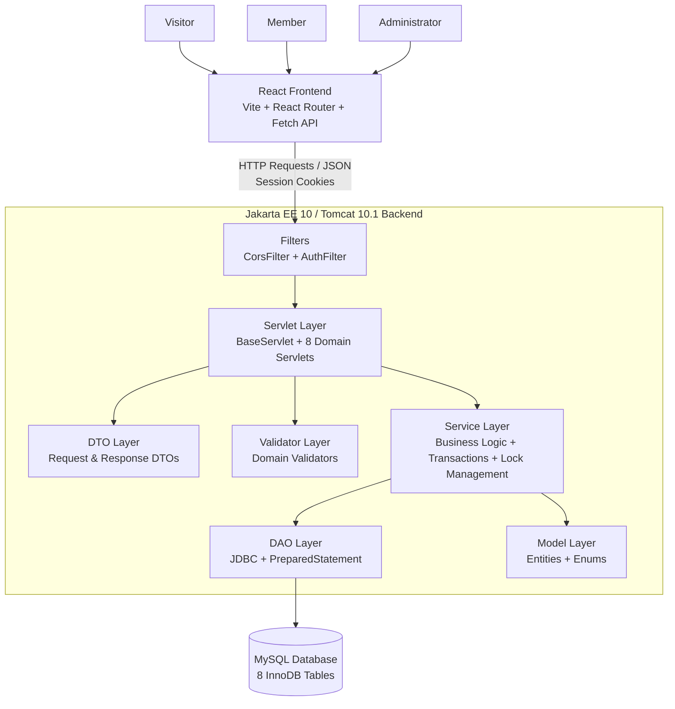
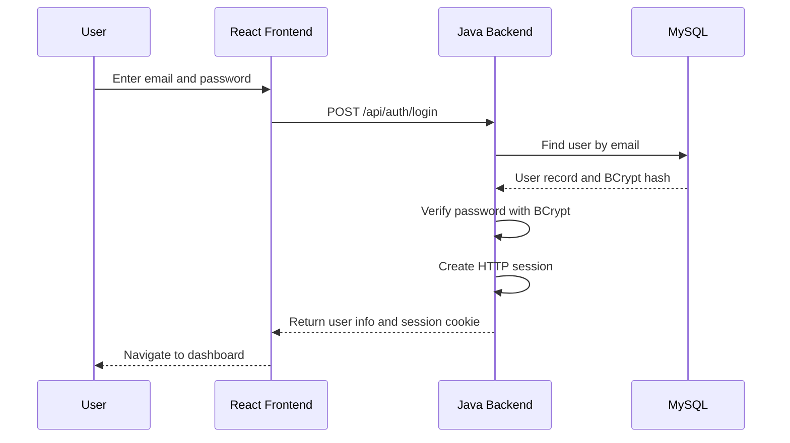
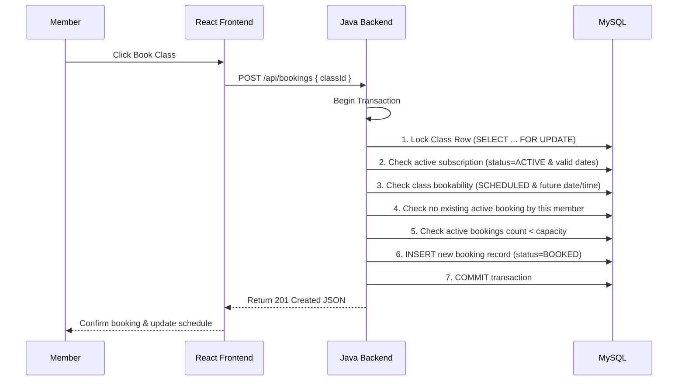

# FitSphere — System Architecture

## 1. Architecture Overview

FitSphere follows a client-server architecture with three main layers:

1. Frontend — React application.
2. Backend — Java Servlet application.
3. Database — MySQL database.

The frontend communicates with the backend through REST-style HTTP endpoints using JSON.

The backend processes requests, validates business rules, manages authentication and authorization, and communicates with MySQL through JDBC.

### General Architecture Diagram



## 2. Frontend Architecture

### 2.1 Technologies

The frontend uses:

- React.js
- JavaScript (not TypeScript)
- Vite
- React Router
- CSS
- Fetch API

### 2.2 Frontend Responsibilities

The frontend is responsible for:

- Displaying the user interface.
- Managing navigation between pages.
- Displaying different interfaces according to user roles.
- Handling user interactions and form inputs.
- Sending HTTP requests to the backend.
- Displaying data returned by the backend.
- Showing success and error messages.
- Maintaining frontend authentication state based on the backend session.

The frontend must not be responsible for enforcing critical security or business rules. These must always be checked by the backend.

### 2.3 Frontend Folder Structure

```text
frontend/
├── AGENTS.md
├── package.json
├── index.html
├── vite.config.js
├── public/
└── src/
    ├── assets/
    │
    ├── components/
    │   ├── common/
    │   ├── visitor/
    │   ├── admin/
    │   └── member/
    │
    ├── features/
    │   ├── visitor/
    │   │   ├── pages/
    │   │   └── components/
    │   │
    │   ├── admin/
    │   │   ├── pages/
    │   │   └── components/
    │   │
    │   └── member/
    │       ├── pages/
    │       └── components/
    │
    ├── context/
    │   └── AuthContext.jsx
    │
    ├── services/
    │   ├── api.js
    │   ├── authService.js
    │   ├── userService.js
    │   ├── trainerService.js
    │   ├── planService.js
    │   ├── subscriptionService.js
    │   ├── paymentService.js
    │   ├── classService.js
    │   └── bookingService.js
    │
    ├── hooks/
    ├── routes/
    │   └── ProtectedRoute.jsx
    │
    ├── App.jsx
    ├── main.jsx
    └── index.css
```

### 2.4 Frontend Organization

**components/common/**
Reusable interface components shared across roles (Header, Sidebar, Buttons, Form controls, Badges, Modals, Loading indicators).

**features/visitor/**
Public pages and components (Homepage, Trainers, Plans, Public Classes, Login).

**features/admin/**
Administrator pages and components (Admin Dashboard, Member CRUD, Trainer CRUD, Plan CRUD, Subscription & Payment Management, Class CRUD, Booking Oversight).

**features/member/**
Member pages and components (Member Dashboard, Profile with self-service name/phone/password editing, Subscription view, Classes, My Bookings history).

**context/**
Shared React context, managing session authentication state through `AuthContext.jsx`.

**services/**
Dedicated API service modules mapping to application domains:
- `api.js`: Base fetch client configuring base URL, JSON headers, and `credentials: "include"`.
- `authService.js`: Login, logout, session check.
- `userService.js`: Admin member management & profile operations.
- `trainerService.js`: Public trainer listing and admin trainer CRUD.
- `planService.js`: Public plans and admin plan CRUD.
- `subscriptionService.js`: Subscription assignment, renewal, and member subscription status.
- `paymentService.js`: Admin manual payment audit and history retrieval. (Payment creation is handled atomically via `userService.js` and `subscriptionService.js`).
- `classService.js`: Public/member schedules and admin class CRUD.
- `bookingService.js`: Member booking/cancellation and admin booking oversight.

**routes/**
Client-side route protection using `ProtectedRoute.jsx`.

## 3. Backend Architecture

### 3.1 Technologies

- Java 17
- Jakarta Servlet 6.0 (`jakarta.servlet.*`)
- JDBC with MySQL Connector/J
- Apache Tomcat 10.1
- Maven
- Gson
- BCrypt

### 3.2 Backend Responsibilities

- Receiving and validating HTTP requests through dedicated DTOs and Validators.
- Authenticating users and managing HTTP sessions securely.
- Enforcing role-based authorization (`PUBLIC`, `MEMBER`, `ADMIN`) via filters and service checks.
- Enforcing core business rules in the Service layer (dynamic subscription validity, bookable future classes, class capacity locks, soft delete).
- Managing transaction boundaries (`connection.setAutoCommit(false)`) and pessimistic row locking (`SELECT ... FOR UPDATE`) in service methods.
- Executing isolated database operations using `PreparedStatement` within DAOs.
- Centralizing exception handling through typed `AppException` subclasses and returning standardized JSON responses.

### 3.3 Backend Folder Structure

```text
backend/
├── AGENTS.md
├── pom.xml
└── src/
    └── main/
        ├── java/
        │   └── com/fitsphere/
        │       ├── config/
        │       │   ├── AppConfig.java
        │       │   ├── DatabaseConfig.java
        │       │   └── DatabaseConnection.java
        │       │
        │       ├── model/
        │       │   ├── enums/
        │       │   │   ├── Role.java
        │       │   │   ├── AccountStatus.java
        │       │   │   ├── SubscriptionStatus.java
        │       │   │   ├── ClassStatus.java
        │       │   │   ├── BookingStatus.java
        │       │   │   ├── PaymentStatus.java
        │       │   │   ├── PaymentMethod.java
        │       │   │   ├── AuditAction.java
        │       │   │   └── EntityType.java
        │       │   │
        │       │   ├── User.java
        │       │   ├── Trainer.java
        │       │   ├── MembershipPlan.java
        │       │   ├── Subscription.java
        │       │   ├── GymClass.java
        │       │   ├── Booking.java
        │       │   ├── Payment.java
        │       │   └── AuditLog.java
        │       │
        │       ├── dto/
        │       │   ├── request/
        │       │   │   ├── LoginRequest.java
        │       │   │   ├── MemberCreateRequest.java
        │       │   │   ├── MemberUpdateRequest.java
        │       │   │   ├── PasswordChangeRequest.java
        │       │   │   ├── TrainerRequest.java
        │       │   │   ├── PlanRequest.java
        │       │   │   ├── ClassRequest.java
        │       │   │   ├── SubscriptionRenewRequest.java
        │       │   │   └── BookingCreateRequest.java
        │       │   │
        │       │   └── response/
        │       │       ├── AuthUserResponse.java
        │       │       ├── UserResponse.java
        │       │       ├── TrainerResponse.java
        │       │       ├── PlanResponse.java
        │       │       ├── SubscriptionResponse.java
        │       │       ├── PaymentResponse.java
        │       │       ├── GymClassResponse.java
        │       │       ├── BookingResponse.java
        │       │       ├── MessageResponse.java
        │       │       └── ErrorResponse.java
        │       │
        │       ├── dao/
        │       │   ├── UserDAO.java
        │       │   ├── TrainerDAO.java
        │       │   ├── MembershipPlanDAO.java
        │       │   ├── SubscriptionDAO.java
        │       │   ├── GymClassDAO.java
        │       │   ├── BookingDAO.java
        │       │   ├── PaymentDAO.java
        │       │   └── AuditLogDAO.java
        │       │
        │       ├── service/
        │       │   ├── AuthService.java
        │       │   ├── UserService.java
        │       │   ├── TrainerService.java
        │       │   ├── PlanService.java
        │       │   ├── SubscriptionService.java
        │       │   ├── PaymentService.java
        │       │   ├── GymClassService.java
        │       │   ├── BookingService.java
        │       │   └── AuditService.java
        │       │
        │       ├── validator/
        │       │   ├── UserValidator.java
        │       │   ├── TrainerValidator.java
        │       │   ├── PlanValidator.java
        │       │   ├── SubscriptionValidator.java
        │       │   ├── GymClassValidator.java
        │       │   └── BookingValidator.java
        │       │
        │       ├── exception/
        │       │   ├── AppException.java
        │       │   ├── ValidationException.java
        │       │   ├── AuthenticationException.java
        │       │   ├── AuthorizationException.java
        │       │   ├── ResourceNotFoundException.java
        │       │   ├── ConflictException.java
        │       │   └── DatabaseException.java
        │       │
        │       ├── servlet/
        │       │   ├── BaseServlet.java
        │       │   ├── AuthServlet.java
        │       │   ├── UserServlet.java
        │       │   ├── TrainerServlet.java
        │       │   ├── PlanServlet.java
        │       │   ├── SubscriptionServlet.java
        │       │   ├── PaymentServlet.java
        │       │   ├── GymClassServlet.java
        │       │   └── BookingServlet.java
        │       │
        │       ├── filter/
        │       │   ├── CorsFilter.java
        │       │   └── AuthFilter.java
        │       │
        │       └── util/
        │           ├── PasswordUtil.java
        │           ├── JsonUtil.java
        │           ├── DateUtil.java
        │           └── ServletUtil.java
        │
        └── webapp/
            └── WEB-INF/
                └── web.xml
```

### 3.4 Layer Architecture & Separation of Concerns

The backend employs a decoupled enterprise architecture. Each layer has strict, non-overlapping responsibilities:

#### 1. Config Layer (`com.fitsphere.config`)
- `DatabaseConfig.java`: Reads required database environment variables (`DB_URL`, `DB_USERNAME`, `DB_PASSWORD`) via `System.getenv(...)`. Throws `IllegalStateException` immediately if any variable is missing or blank, preventing silent misconfiguration.
- `DatabaseConnection.java`: Manages thread-safe JDBC connection acquisition.
  - **Connection Management Model:** Supports dual-mode connection vending:
    - *Container Mode (Tomcat JNDI):* Looks up container-managed connection pool (`InitialContext().lookup("java:comp/env/jdbc/FitSphereDB")`) when deployed in Tomcat.
    - *Standalone / Direct Mode:* Uses `DriverManager.getConnection(...)` with strict thread isolation.
  - **Concurrency & Resource Safety:** Each incoming HTTP request thread acquires its own connection and releases it deterministically via `try-with-resources` (`AutoCloseable`). Connections are never shared across concurrent request threads.
- `AppConfig.java`: Central application constants (CORS allowed origins, session timeout, BCrypt cost factor).

#### 2. Model Layer (`com.fitsphere.model`)
POJOs representing persistent domain entities and type-safe Java enums:
- **Entities:** `User`, `Trainer`, `MembershipPlan`, `Subscription`, `GymClass`, `Booking`, `Payment`, `AuditLog`.
- **Enums (`model.enums`):**
  - `Role` (`ADMIN`, `MEMBER`)
  - `AccountStatus` (`ACTIVE`, `INACTIVE`)
  - `SubscriptionStatus` (`ACTIVE`, `EXPIRED`, `CANCELLED`)
  - `ClassStatus` (`SCHEDULED`, `CANCELLED`, `COMPLETED`)
  - `BookingStatus` (`BOOKED`, `CANCELLED`)
  - `PaymentStatus` (`PAID`, `CANCELLED`)
  - `PaymentMethod` (`CASH`, `CARD`)
  - `AuditAction` (`MEMBER_CREATED`, `MEMBER_DEACTIVATED`, `PLAN_DEACTIVATED`, `TRAINER_DEACTIVATED`, `CLASS_CANCELLED`, `SUBSCRIPTION_CANCELLED`, `BOOKING_CANCELLED`)
  - `EntityType` (`USER`, `PLAN`, `TRAINER`, `CLASS`, `SUBSCRIPTION`, `BOOKING`)

#### 3. DTO Layer (`com.fitsphere.dto`)
Data Transfer Objects that cleanly isolate internal database representations from external HTTP JSON payloads.
- **Request DTOs:** Capture and type-cast incoming JSON payloads (e.g., `MemberCreateRequest` encapsulating the 3-in-1 member, plan, and payment input; `BookingCreateRequest`).
- **Response DTOs:** Ensure sensitive fields (e.g., BCrypt password hashes) are never exposed. Produce clean response structures matching `docs/API_CONTRACT.md` exactly.

#### 4. Validator Layer (`com.fitsphere.validator`)
Dedicated validator classes that verify structural integrity, email formats, positive numeric ranges, non-blank strings, and date relationships before domain execution:
- `UserValidator`: Validates name lengths, email regex, phone formatting, and password constraints (minimum 6 characters, no whitespace).
- `SubscriptionValidator`: Ensures `startDate` and `durationMonths` are positive and valid.
- `GymClassValidator`: Ensures `capacity > 0`, `end_time > start_time`, and valid date/time logic.
- `BookingValidator`: Checks booking input parameters.
- When validation fails, validators throw typed `ValidationException` with field-specific errors, mapped to `400 Bad Request` and `INVALID_INPUT`.

#### 5. Exception Layer (`com.fitsphere.exception`)
Hierarchical typed exceptions mapping directly to HTTP status codes and contract error codes:
- `AppException`: Base unchecked application exception containing `errorCode` and HTTP status.
- `ValidationException` (HTTP 400, `INVALID_INPUT` / `VALIDATION_ERROR`)
- `AuthenticationException` (HTTP 401, `UNAUTHORIZED` / `INVALID_CREDENTIALS`)
- `AuthorizationException` (HTTP 403, `FORBIDDEN`)
- `ResourceNotFoundException` (HTTP 404, `USER_NOT_FOUND`, `CLASS_NOT_FOUND`, etc.)
- `ConflictException` (HTTP 409, `DUPLICATE_EMAIL`, `CLASS_FULL`, `DUPLICATE_BOOKING`)
- `DatabaseException` (HTTP 500, `DATABASE_ERROR`)

#### 6. Service Layer (`com.fitsphere.service`)
Core domain orchestrator where business logic, transaction boundaries, and pessimistic locks are managed:
- **`UserService`:** Coordinates the atomic 3-in-1 member registration transaction (`User` + `Subscription` + `Payment` + `AuditLog`). Manages profile updates and soft delete (`account_status = 'INACTIVE'`).
- **`SubscriptionService`:** Computes dynamic subscription validity (`status = 'ACTIVE'` and `CURRENT_DATE BETWEEN start_date AND end_date`). Coordinates atomic subscription renewal transactions (`Subscription` + `Payment` + `AuditLog`).
- **`BookingService`:** Executes the 8-step booking engine with transaction boundaries and pessimistic class row locking (`SELECT ... FOR UPDATE`), active subscription checks, capacity deduction, cancellation, and rebooking.
- **`GymClassService`:** Evaluates dynamic `isBookable` status, manages class creation, updates, and cancellations.
- **`TrainerService` & `PlanService`:** Handles CRUD and soft-deletion (`is_active = FALSE`).
- **`PaymentService`:** Audits and queries physical payment records.
- **`AuditService`:** Manages immutable audit logs. Enforces atomic execution inside the caller's business transaction (`connection.setAutoCommit(false)`), and sanitizes details to guarantee that no credentials, passwords, or tokens are ever persisted.

#### 7. DAO Layer (`com.fitsphere.dao`)
Pure JDBC data access objects without unnecessary generic abstractions (`BaseDAO` omitted in favor of explicit, type-safe JDBC methods).
- DAOs execute parameterized SQL via `PreparedStatement` and map `ResultSet` rows to domain entities.
- DAOs accept either a standalone connection or an external transactional `Connection` passed from the Service layer, allowing multi-table mutations to share an atomic transaction boundary.
- All SQL statements use parameterized queries (`?`) to prevent SQL injection.

#### 8. Servlet Layer (`com.fitsphere.servlet`)
Thin HTTP controllers extending `BaseServlet`:
- **`BaseServlet`:** Indispensable base controller that eliminates cross-cutting boilerplate across all 8 domain servlets:
  - Centralized request body deserialization via `JsonUtil.fromJson(request.getReader(), ...)`.
  - Standardized JSON response generation (`Content-Type: application/json; charset=UTF-8`).
  - Session identity extraction (`getAuthenticatedUser(request)`, `requireRole(request, Role...)`).
  - Path parameter parsing (e.g. extracting numeric IDs from `/api/users/{id}`).
  - Centralized error handling: Catches `AppException` subclasses and translates them into uniform error envelopes `{ "error": "...", "message": "..." }` with matching HTTP status codes (`400`, `401`, `403`, `404`, `409`, `500`).
- Domain servlets (`AuthServlet`, `UserServlet`, `TrainerServlet`, `PlanServlet`, `SubscriptionServlet`, `PaymentServlet`, `GymClassServlet`, `BookingServlet`) handle URL path routing, DTO extraction, delegate to the corresponding Service, and return responses.

#### 9. Filter Layer (`com.fitsphere.filter`)
- `AuthFilter`: Enforces server-side session authentication and role validation (`PUBLIC`, `MEMBER`, `ADMIN`), protecting secure endpoints.
- `CorsFilter`: Handles CORS headers for `http://localhost:3000` with `Access-Control-Allow-Credentials: true` and responds to `OPTIONS` preflight requests immediately with `200 OK`.

#### 10. Util Layer (`com.fitsphere.util`)
- `PasswordUtil`: BCrypt hashing and verification.
- `JsonUtil`: Gson serialization configured with ISO date adapters.
- `DateUtil`: Date arithmetic (e.g. `startDate.plusMonths(duration).minusDays(1)`).
- `ServletUtil`: HTTP request parameter extraction and path parsing.

## 4. Workflows & Communication

### 4.1 Login Workflow



### 4.2 Class Booking Workflow



Locking the class row **first** serializes concurrent requests for that class, preventing race conditions, double-bookings, and capacity overages.

## 5. Deletion & Data Integrity Policy (Soft Delete)

- **Members:** Soft deleted by setting `account_status = 'INACTIVE'`. Physical deletion is blocked to preserve historical subscriptions, bookings, and payments.
- **Trainers:** Soft deleted by setting `is_active = FALSE`.
- **Plans:** Soft deleted by setting `is_active = FALSE`.
- **Bookings:** Cancellation sets `status = 'CANCELLED'`. Never physically deleted.

## 6. Authentication and Authorization Architecture

- **Session-Based:** Handled via Jakarta `HttpSession`.
- **Session Identity (`/auth/me` vs `/users/me`):**
  - `GET /api/auth/me` is universally accessible to both `MEMBER` and `ADMIN`. It is used by both Member and Administrator dashboards upon page load/refresh to retrieve authenticated user details (`id`, `fullName`, `email`, `role`, `accountStatus`).
  - `GET /api/users/me` is dedicated exclusively to Member profile self-service. Administrator accounts do not have member profiles and manage their session identity via `/auth/me`.
- **CORS Credentials:** Client requests send session cookies via `credentials: "include"`.
- **Password Security:** Hashes stored using BCrypt. Mandatory password change on first login is not required; password changes occur via self-service profile endpoint (`PUT /api/users/me/password`).
- **Backend Authorization:** Role check (`ADMIN`, `MEMBER`) validated on the server for all protected endpoints.

## 7. Related Documentation

| Document | Purpose |
|---|---|
| `PROJECT_CONTEXT.md` | Central project overview |
| `PROJECT_REQUIREMENTS.md` | Functional and non-functional requirements |
| `DATABASE_SCHEMA.md` | Database design |
| `API_CONTRACT.md` | API endpoints and data formats |
| `DEVELOPMENT_WORKFLOW.md` | Team responsibilities and collaboration |
| `TASKS.md` | Development task breakdown |
