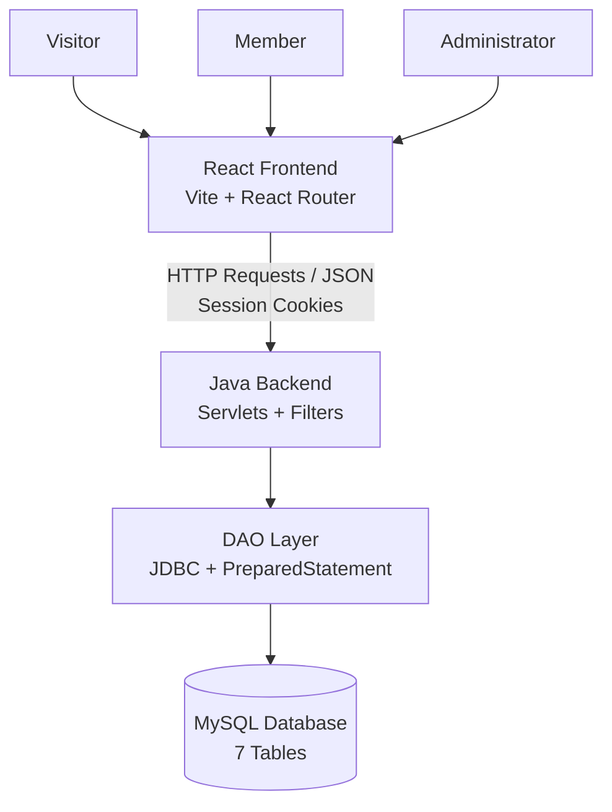
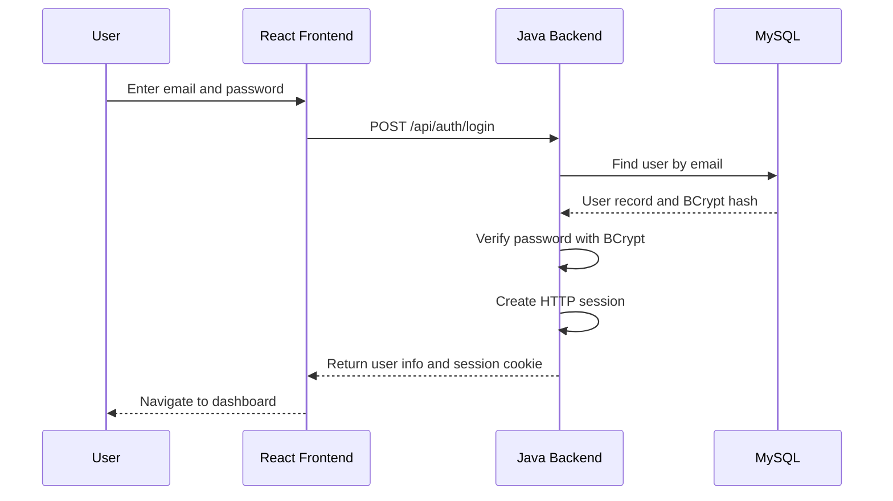
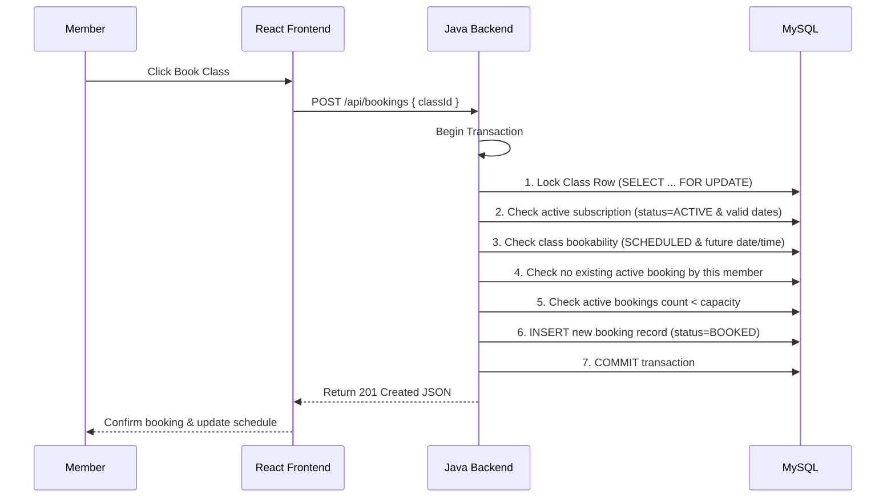

# FitSphere — System Architecture

## 1. Architecture Overview

FitSphere follows a client-server architecture with three main layers:

1. Frontend — React application.
2. Backend — Java Servlet application.
3. Database — MySQL database.

The frontend communicates with the backend through REST-style HTTP endpoints using JSON.

The backend processes requests, validates business rules, manages authentication and authorization, and communicates with MySQL through JDBC.

### General Architecture Diagram



## 2. Frontend Architecture

### 2.1 Technologies

The frontend uses:

- React.js
- JavaScript (not TypeScript)
- Vite
- React Router
- CSS
- Fetch API

### 2.2 Frontend Responsibilities

The frontend is responsible for:

- Displaying the user interface.
- Managing navigation between pages.
- Displaying different interfaces according to user roles.
- Handling user interactions and form inputs.
- Sending HTTP requests to the backend.
- Displaying data returned by the backend.
- Showing success and error messages.
- Maintaining frontend authentication state based on the backend session.

The frontend must not be responsible for enforcing critical security or business rules. These must always be checked by the backend.

### 2.3 Frontend Folder Structure

```text
frontend/
├── AGENTS.md
├── package.json
├── index.html
├── vite.config.js
├── public/
└── src/
    ├── assets/
    │
    ├── components/
    │   ├── common/
    │   ├── visitor/
    │   ├── admin/
    │   └── member/
    │
    ├── features/
    │   ├── visitor/
    │   │   ├── pages/
    │   │   └── components/
    │   │
    │   ├── admin/
    │   │   ├── pages/
    │   │   └── components/
    │   │
    │   └── member/
    │       ├── pages/
    │       └── components/
    │
    ├── context/
    │   └── AuthContext.jsx
    │
    ├── services/
    │   ├── api.js
    │   ├── authService.js
    │   ├── userService.js
    │   ├── trainerService.js
    │   ├── planService.js
    │   ├── subscriptionService.js
    │   ├── paymentService.js
    │   ├── classService.js
    │   └── bookingService.js
    │
    ├── hooks/
    ├── routes/
    │   └── ProtectedRoute.jsx
    │
    ├── App.jsx
    ├── main.jsx
    └── index.css
```

### 2.4 Frontend Organization

**components/common/**
Reusable interface components shared across roles (Header, Sidebar, Buttons, Form controls, Badges, Modals, Loading indicators).

**features/visitor/**
Public pages and components (Homepage, Trainers, Plans, Public Classes, Login).

**features/admin/**
Administrator pages and components (Admin Dashboard, Member CRUD, Trainer CRUD, Plan CRUD, Subscription & Payment Management, Class CRUD, Booking Oversight).

**features/member/**
Member pages and components (Member Dashboard, Profile with self-service name/phone/password editing, Subscription view, Classes, My Bookings history).

**context/**
Shared React context, managing session authentication state through `AuthContext.jsx`.

**services/**
Dedicated API service modules mapping to application domains:
- `api.js`: Base fetch client configuring base URL, JSON headers, and `credentials: "include"`.
- `authService.js`: Login, logout, session check.
- `userService.js`: Admin member management & profile operations.
- `trainerService.js`: Public trainer listing and admin trainer CRUD.
- `planService.js`: Public plans and admin plan CRUD.
- `subscriptionService.js`: Subscription assignment, renewal, and member subscription status.
- `paymentService.js`: Admin manual payment audit and history retrieval. (Payment creation is handled atomically via `userService.js` and `subscriptionService.js`).
- `classService.js`: Public/member schedules and admin class CRUD.
- `bookingService.js`: Member booking/cancellation and admin booking oversight.

**routes/**
Client-side route protection using `ProtectedRoute.jsx`.

## 3. Backend Architecture

### 3.1 Technologies

- Java 17
- Jakarta Servlet 6.0 (`jakarta.servlet.*`)
- JDBC with MySQL Connector/J
- Apache Tomcat 10.1
- Maven
- Gson
- BCrypt

### 3.2 Backend Responsibilities

- Receiving and validating HTTP requests.
- Authenticating users and managing HTTP sessions.
- Enforcing role-based authorization (`PUBLIC`, `MEMBER`, `ADMIN`).
- Enforcing business rules (dynamic subscription validity, bookable future classes, capacity checks, soft delete).
- Executing database operations using `PreparedStatement` and managing transactions.
- Returning standardized JSON responses.

### 3.3 Backend Folder Structure

```text
backend/
├── AGENTS.md
├── pom.xml
└── src/
    └── main/
        ├── java/
        │   └── com/fitsphere/
        │       ├── model/
        │       ├── dao/
        │       ├── servlet/
        │       ├── config/
        │       ├── filter/
        │       └── util/
        │
        └── webapp/
            └── WEB-INF/
                └── web.xml
```

### 3.4 Backend Layers

#### Model Layer
Plain Java Objects (POJOs) representing the 7 database entities:
- `User`
- `Trainer`
- `MembershipPlan`
- `Subscription`
- `GymClass`
- `Booking`
- `Payment`

#### DAO Layer
Data Access Objects executing SQL via `PreparedStatement`:
- `UserDAO`
- `TrainerDAO`
- `MembershipPlanDAO`
- `SubscriptionDAO`
- `GymClassDAO`
- `BookingDAO`
- `PaymentDAO`

#### Servlet Layer
HTTP request controllers dispatching actions and serializing JSON via Gson:
- `AuthServlet` (`/api/auth/*`)
- `UserServlet` (`/api/users/*`, `/api/admin/members/*`)
- `TrainerServlet` (`/api/trainers/*`)
- `PlanServlet` (`/api/plans/*`)
- `SubscriptionServlet` (`/api/subscriptions/*`)
- `PaymentServlet` (`/api/payments/*` — handles administrative payment retrieval and audit queries)
- `GymClassServlet` (`/api/classes/*`)
- `BookingServlet` (`/api/bookings/*`)

#### Config Layer
Database connection pool and configuration (`DatabaseConfig.java` / `DatabaseConnection.java`):
- Required environment variables: `DB_URL`, `DB_USERNAME`, `DB_PASSWORD`.
- Read configuration using `System.getenv(...)`. Variables may be configured via workstation environment variables or Apache Tomcat's `bin/setenv.bat` (Windows) / `bin/setenv.sh` (Linux).
- If any required environment variable is missing or blank, `DatabaseConfig` must immediately throw a descriptive `IllegalStateException` (e.g., `"Missing required database environment variable: DB_PASSWORD"`).
- Never use hardcoded database credentials or default passwords.
- Provides thread-safe JDBC connections closed via try-with-resources.

#### Filter Layer
Cross-cutting HTTP filters:
- `AuthFilter`: Enforces session validation and role authorization (`PUBLIC`, `MEMBER`, `ADMIN`), blocking unauthorized access before reaching servlets.
- `CorsFilter`: Configured for decoupled frontend-backend communication:
  - `Access-Control-Allow-Origin: http://localhost:3000`
  - `Access-Control-Allow-Methods: GET, POST, PUT, DELETE, OPTIONS`
  - `Access-Control-Allow-Headers: Content-Type, Accept`
  - `Access-Control-Allow-Credentials: true`
  - Intercepts and immediately answers HTTP `OPTIONS` preflight requests with `200 OK` and an empty body.

#### Util Layer
- `PasswordUtil`: BCrypt hashing and verification. Enforces minimum 6-character length without whitespace.
- `JsonUtil`: Standardized JSON serialization using Gson adhering to `docs/API_CONTRACT.md`.

## 4. Workflows & Communication

### 4.1 Login Workflow



### 4.2 Class Booking Workflow



Locking the class row **first** serializes concurrent requests for that class, preventing race conditions, double-bookings, and capacity overages.

## 5. Deletion & Data Integrity Policy (Soft Delete)

- **Members:** Soft deleted by setting `account_status = 'INACTIVE'`. Physical deletion is blocked to preserve historical subscriptions, bookings, and payments.
- **Trainers:** Soft deleted by setting `is_active = FALSE`.
- **Plans:** Soft deleted by setting `is_active = FALSE`.
- **Bookings:** Cancellation sets `status = 'CANCELLED'`. Never physically deleted.

## 6. Authentication and Authorization Architecture

- **Session-Based:** Handled via Jakarta `HttpSession`.
- **Session Identity (`/auth/me` vs `/users/me`):**
  - `GET /api/auth/me` is universally accessible to both `MEMBER` and `ADMIN`. It is used by both Member and Administrator dashboards upon page load/refresh to retrieve authenticated user details (`id`, `fullName`, `email`, `role`, `accountStatus`).
  - `GET /api/users/me` is dedicated exclusively to Member profile self-service. Administrator accounts do not have member profiles and manage their session identity via `/auth/me`.
- **CORS Credentials:** Client requests send session cookies via `credentials: "include"`.
- **Password Security:** Hashes stored using BCrypt. Mandatory password change on first login is not required; password changes occur via self-service profile endpoint (`PUT /api/users/me/password`).
- **Backend Authorization:** Role check (`ADMIN`, `MEMBER`) validated on the server for all protected endpoints.

## 7. Related Documentation

| Document | Purpose |
|---|---|
| `PROJECT_CONTEXT.md` | Central project overview |
| `PROJECT_REQUIREMENTS.md` | Functional and non-functional requirements |
| `DATABASE_SCHEMA.md` | Database design |
| `API_CONTRACT.md` | API endpoints and data formats |
| `DEVELOPMENT_WORKFLOW.md` | Team responsibilities and collaboration |
| `TASKS.md` | Development task breakdown |
