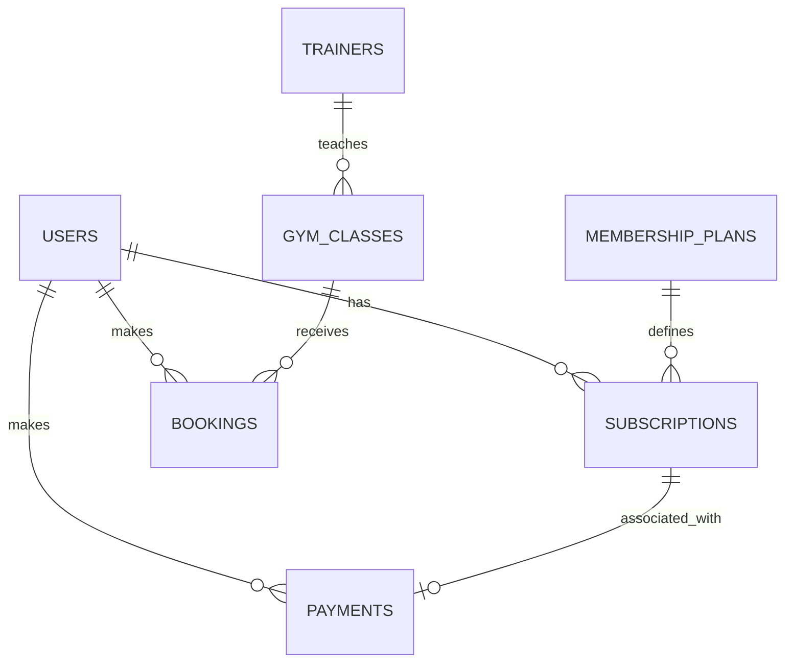

# FitSphere — Database Schema

## 1. Overview

FitSphere uses MySQL as its relational database management system.

The database stores and manages:

- User accounts (`users`).
- Trainers (`trainers`).
- Membership plans (`membership_plans`).
- Member subscriptions (`subscriptions`).
- Gym classes (`gym_classes`).
- Class bookings (`bookings`).
- Manual payment records (`payments`).

The database must maintain data consistency through primary keys, foreign keys, constraints, and transactions.

**Database name:** `fitsphere`

**Storage engine:** InnoDB

**Character encoding:** `utf8mb4`

## 2. Database Tables

The database consists of seven main tables.

### 2.1 users

Stores administrator and member account information.

| Column | Data type | Constraints | Description |
|---|---|---|---|
| id | BIGINT | PK, AUTO_INCREMENT | User identifier |
| full_name | VARCHAR(100) | NOT NULL | Full name |
| email | VARCHAR(150) | NOT NULL, UNIQUE | Login email (admin-managed identifier) |
| password | VARCHAR(255) | NOT NULL | BCrypt password hash |
| phone | VARCHAR(20) | NULL | Phone number |
| role | ENUM | NOT NULL | `ADMIN` or `MEMBER` |
| account_status | ENUM | NOT NULL, DEFAULT `ACTIVE` | `ACTIVE` or `INACTIVE` |
| created_at | TIMESTAMP | DEFAULT CURRENT_TIMESTAMP | Account creation date |

**Important rules:**
- Email addresses must be unique.
- Passwords must always be stored as BCrypt hashes.
- Public registration is not allowed. Only administrators can create member accounts.
- Mandatory password change on first login is not required. Members receive their initial credentials and can log in immediately; they may optionally change their password later via their profile.
- Account status is independent of subscription status.
- An expired subscription must never automatically delete or deactivate a member account.
- Deletion is handled as a **Soft Delete**: deleting a member sets `account_status = 'INACTIVE'`. Physical SQL `DELETE` is prohibited for members who have subscription, booking, or payment history.

### 2.2 trainers

Stores gym trainer information.

| Column | Data type | Constraints | Description |
|---|---|---|---|
| id | BIGINT | PK, AUTO_INCREMENT | Trainer identifier |
| full_name | VARCHAR(100) | NOT NULL | Trainer name |
| specialization | VARCHAR(100) | NOT NULL | Training specialization |
| phone | VARCHAR(20) | NULL | Phone number |
| email | VARCHAR(150) | NULL, UNIQUE | Email address |
| is_active | BOOLEAN | NOT NULL, DEFAULT TRUE | Trainer active availability |

**Important rules:**
- A trainer can be assigned to multiple gym classes.
- Inactive trainers cannot be assigned to new classes.
- Existing class history must be preserved when a trainer becomes inactive.
- Deletion is handled as a **Soft Delete**: deleting a trainer sets `is_active = FALSE`. Physical SQL `DELETE` is disallowed for trainers referenced by existing gym classes.

### 2.3 membership_plans

Stores the membership plans offered by the gym.

| Column | Data type | Constraints | Description |
|---|---|---|---|
| id | BIGINT | PK, AUTO_INCREMENT | Plan identifier |
| name | VARCHAR(100) | NOT NULL, UNIQUE | Plan name |
| duration_months | INT | NOT NULL | Duration in months |
| price | DECIMAL(10,2) | NOT NULL | Plan price |
| description | TEXT | NULL | Plan description |
| is_active | BOOLEAN | NOT NULL, DEFAULT TRUE | Plan availability |

**Important rules:**
- Duration must be greater than zero.
- Price must not be negative.
- Inactive plans cannot be assigned to new subscriptions.
- Existing subscriptions must retain their original plan reference even if the plan later becomes inactive.
- Deletion is handled as a **Soft Delete**: deleting a plan sets `is_active = FALSE`. Physical SQL `DELETE` is disallowed for plans referenced by historical subscriptions.

### 2.4 subscriptions

Stores membership subscriptions.

A member can have multiple subscriptions over time, but each subscription belongs to one member and one membership plan.

| Column | Data type | Constraints | Description |
|---|---|---|---|
| id | BIGINT | PK, AUTO_INCREMENT | Subscription identifier |
| user_id | BIGINT | FK, NOT NULL | Member reference |
| plan_id | BIGINT | FK, NOT NULL | Membership plan reference |
| start_date | DATE | NOT NULL | Subscription start date |
| end_date | DATE | NOT NULL | Subscription expiration date |
| status | ENUM | NOT NULL, DEFAULT `ACTIVE` | `ACTIVE`, `EXPIRED`, `CANCELLED` |
| created_at | TIMESTAMP | DEFAULT CURRENT_TIMESTAMP | Record creation date |

**Foreign keys:**
- `user_id` references `users(id)`.
- `plan_id` references `membership_plans(id)`.

**Important rules:**
- Only users with the `MEMBER` role can own subscriptions.
- The end date must not be earlier than the start date.
- A member can have multiple subscription records over time. Previous subscriptions must be preserved as history.
- Renewing a subscription inserts a new record for the existing member; it does not overwrite the previous subscription.
- Subscription expiration does not delete or deactivate the user account.
- **Dynamic Subscription Validity:**
  - There is no cron job, scheduled task, or background worker responsible for automatically updating expired subscriptions.
  - Subscription validity must always be calculated dynamically by the backend using:
    - `status = 'ACTIVE'`
    - Current date between `start_date` and `end_date`, inclusive (`CURRENT_DATE BETWEEN start_date AND end_date`).
  - An `ACTIVE` status in the database does not automatically mean the subscription is currently valid if the calendar date has passed `end_date`.
  - When the end date passes, the database status may remain `ACTIVE`, but the backend dynamically treats it as invalid/expired.
  - `CANCELLED` is used when an administrator manually cancels a subscription.
  - `EXPIRED` may be used as a stored status when explicitly updated, but automatic status updates are not required for subscription validity.
  - All member operations requiring an active subscription (especially class booking) must use this dynamic check.

### 2.5 gym_classes

Stores scheduled gym classes.

| Column | Data type | Constraints | Description |
|---|---|---|---|
| id | BIGINT | PK, AUTO_INCREMENT | Class identifier |
| name | VARCHAR(100) | NOT NULL | Class name |
| description | TEXT | NULL | Class description |
| trainer_id | BIGINT | FK, NOT NULL | Assigned trainer |
| class_date | DATE | NOT NULL | Class date |
| start_time | TIME | NOT NULL | Starting time |
| end_time | TIME | NOT NULL | Ending time |
| capacity | INT | NOT NULL | Maximum participants |
| status | ENUM | NOT NULL, DEFAULT `SCHEDULED` | `SCHEDULED`, `CANCELLED`, `COMPLETED` |
| created_at | TIMESTAMP | DEFAULT CURRENT_TIMESTAMP | Creation date |

**Foreign key:**
- `trainer_id` references `trainers(id)`.

**Important rules:**
- Every class must have one assigned trainer.
- Capacity must be greater than zero.
- End time must be later than start time.
- Cancelled and completed classes cannot accept new bookings.
- **Bookable Class Condition:**
  A gym class is bookable only when BOTH conditions are satisfied:
  1. Its status is `SCHEDULED`.
  2. Its starting date and time are still in the future:
     ```sql
     status = 'SCHEDULED'
     AND (
         class_date > CURRENT_DATE
         OR (
             class_date = CURRENT_DATE
             AND start_time > CURRENT_TIME
         )
     )
     ```
  - Members cannot book classes whose start time has already passed.
  - Members cannot book classes scheduled for previous dates.
  - A class with status `CANCELLED` or `COMPLETED` cannot be booked.
  - The administrator does not need to manually mark a past class as `COMPLETED` for booking to become unavailable.
  - This validation must be enforced by the Java backend, not only the React frontend.
- Existing booking history must be preserved when a class is cancelled.

### 2.6 bookings

Stores member bookings for gym classes.

| Column | Data type | Constraints | Description |
|---|---|---|---|
| id | BIGINT | PK, AUTO_INCREMENT | Booking identifier |
| user_id | BIGINT | FK, NOT NULL | Member reference |
| class_id | BIGINT | FK, NOT NULL | Gym class reference |
| booking_date | TIMESTAMP | DEFAULT CURRENT_TIMESTAMP | Booking creation date |
| status | ENUM | NOT NULL, DEFAULT `BOOKED` | `BOOKED` or `CANCELLED` |

**Foreign keys:**
- `user_id` references `users(id)`.
- `class_id` references `gym_classes(id)`.

**Important constraints and rules:**
- Only members can create bookings.
- **Booking History & Duplicates:**
  - There is **no unique constraint on `(user_id, class_id)`** in the database table so that complete booking and cancellation history is preserved.
  - Each booking attempt that is successfully created must have its own database record (`INSERT`).
  - When a member cancels a booking, update the existing record's status to `CANCELLED`. Do not delete it.
  - If the member books the same class again after cancelling, **INSERT a new booking record** instead of reactivating the cancelled one.
  - The backend must prevent multiple active (`BOOKED`) bookings by the same member for the same class:
    ```sql
    SELECT COUNT(*) FROM bookings 
    WHERE user_id = ? AND class_id = ? AND status = 'BOOKED'
    ```
  - Perform the duplicate-active-booking check and insertion safely within a database transaction to prevent concurrent duplicate bookings.
  - Cancelled bookings do not count toward class capacity.
  - A member must have a valid active subscription to create a booking.
  - Members can cancel only their own bookings.

### 2.7 payments

Stores manually recorded payments received physically at the gym.

This table is for administrative tracking only. It does not process online payments.

| Column | Data type | Constraints | Description |
|---|---|---|---|
| id | BIGINT | PK, AUTO_INCREMENT | Payment identifier |
| user_id | BIGINT | FK, NOT NULL | Member reference |
| subscription_id | BIGINT | FK, NOT NULL, UNIQUE | Associated subscription |
| amount | DECIMAL(10,2) | NOT NULL | Amount received |
| payment_date | DATE | NOT NULL | Date payment was received |
| payment_status | ENUM | NOT NULL, DEFAULT `PAID` | `PAID` or `CANCELLED` |
| created_at | TIMESTAMP | DEFAULT CURRENT_TIMESTAMP | Record creation date |

**Foreign keys:**
- `user_id` references `users(id)`.
- `subscription_id` references `subscriptions(id)`.

**Important rules:**
- Each payment record belongs to one member and one subscription.
- Each subscription has at most one payment record (`UNIQUE` on `subscription_id`).
- Payment records are created exclusively within the initial member creation (`POST /users`) and subscription renewal (`POST /subscriptions`) workflows inside an atomic database transaction. Standalone payment creation is not supported.
- The recorded amount must not be negative.
- Payments are recorded only after the administrator verifies physical receipt of money.
- No bank card details or online payment credentials are stored.
- Payment records must be preserved for administrative history.

## 3. Table Relationships

| Relationship | Type | Explanation |
|---|---|---|
| users → subscriptions | One-to-many | One member can have multiple subscriptions over time |
| membership_plans → subscriptions | One-to-many | One plan can be used by multiple subscriptions |
| trainers → gym_classes | One-to-many | One trainer can teach multiple classes |
| users → bookings | One-to-many | One member can have multiple bookings (history preserved) |
| gym_classes → bookings | One-to-many | One class can receive multiple bookings |
| users → payments | One-to-many | One member can have multiple payment records |
| subscriptions → payments | One-to-one | Each subscription is associated with at most one payment record |

### Relationship Diagram



## 4. Important Database Constraints

1. Every table must have a primary key (`id BIGINT AUTO_INCREMENT`).
2. Emails must be unique in `users` and unique when provided in `trainers`.
3. Membership plan names must be unique.
4. Foreign keys must enforce relational integrity:
   - `subscriptions.user_id` → `users(id)`
   - `subscriptions.plan_id` → `membership_plans(id)`
   - `gym_classes.trainer_id` → `trainers(id)`
   - `bookings.user_id` → `users(id)`
   - `bookings.class_id` → `gym_classes(id)`
   - `payments.user_id` → `users(id)`
   - `payments.subscription_id` → `subscriptions(id)` (UNIQUE)
5. Class capacity must be greater than zero.
6. The backend enforces that a member cannot have more than one active (`BOOKED`) booking for the same class at the same time.
7. End date must be greater than or equal to start date for subscriptions.
8. End time must be later than start time for gym classes.
9. Amounts and prices must not be negative.

## 5. Indexing Recommendations

The following columns should be indexed for query performance:

- `users.email` (provided by UNIQUE)
- `users.role`
- `subscriptions.user_id`
- `subscriptions.plan_id`
- `subscriptions.status`
- `gym_classes.trainer_id`
- `gym_classes.class_date`
- `bookings.user_id`
- `bookings.class_id`
- `bookings.status`
- `payments.user_id`
- `payments.subscription_id` (provided by UNIQUE)

## 6. Data Integrity and Deletion Policy (Soft Delete)

FitSphere adopts a **Soft Delete** strategy for historical integrity:

- **Members:** Deleting a member updates `account_status = 'INACTIVE'`. Physical `DELETE` is prohibited for members who have subscription, booking, or payment history.
- **Trainers:** Deleting a trainer updates `is_active = FALSE`. Inactive trainers remain referenced by past classes.
- **Membership Plans:** Deleting a plan updates `is_active = FALSE`. Inactive plans remain referenced by historical subscriptions.
- **Subscriptions:** Never deleted when expired. Preserved for billing and membership records.
- **Bookings:** Cancelling a booking updates `status = 'CANCELLED'`. Never physically deleted, providing an audit trail of bookings and cancellations.
- **Foreign Keys:** Use `ON DELETE RESTRICT` on historical tables to prevent accidental cascading data loss.

## 7. Transaction Requirements

Multi-step operations must be executed inside database transactions (`connection.setAutoCommit(false)`):

### 7.1 Creating a New Member (3-in-1 Workflow)
The administrator workflow creates three related records atomically in a single transaction:
1. Validate that all required member, plan, and payment fields are provided (initial subscription and payment are **mandatory**). Verify password meets policy (minimum 6 characters, no spaces).
2. `INSERT INTO users (...)` (create member account)
3. Compute `end_date` using inclusive calendar range: `startDate.plusMonths(durationMonths).minusDays(1)`.
4. `INSERT INTO subscriptions (...)` (create initial subscription)
5. `INSERT INTO payments (...)` (record manual verified payment)
6. `connection.commit()`

If any step fails, `connection.rollback()` reverts all changes.

### 7.2 Renewing a Subscription
1. Verify member and payment physically.
2. Compute `end_date` using inclusive calendar range: `startDate.plusMonths(durationMonths).minusDays(1)`.
3. `INSERT INTO subscriptions (...)` (new subscription record for existing member)
4. `INSERT INTO payments (...)` (payment record for new subscription)
5. `connection.commit()`

### 7.3 Booking a Class (Strict Concurrency & Row-Locking Sequence)
To prevent simultaneous requests from exceeding capacity or creating duplicate active bookings, the backend executes this exact sequence:
1. **Begin Transaction:** `connection.setAutoCommit(false)`.
2. **Lock Class Row First:**
   ```sql
   SELECT id, capacity, status, class_date, start_time 
   FROM gym_classes 
   WHERE id = ? 
   FOR UPDATE
   ```
   *Acquiring this exclusive row lock first serializes all concurrent booking attempts for this class.*
3. **Check Subscription Validity:**
   ```sql
   SELECT id FROM subscriptions 
   WHERE user_id = ? AND status = 'ACTIVE' AND CURRENT_DATE BETWEEN start_date AND end_date
   ```
4. **Check Class Bookability:** Verify locked class has `status = 'SCHEDULED'` and `(class_date > CURRENT_DATE OR (class_date = CURRENT_DATE AND start_time > CURRENT_TIME))`.
5. **Check Existing Active Booking:**
   ```sql
   SELECT COUNT(*) FROM bookings 
   WHERE user_id = ? AND class_id = ? AND status = 'BOOKED'
   ```
   If count > 0, rollback (duplicate booking).
6. **Check Available Capacity:**
   ```sql
   SELECT COUNT(*) FROM bookings 
   WHERE class_id = ? AND status = 'BOOKED'
   ```
   If `activeBookingsCount >= capacity`, rollback (class full).
7. **Insert New Booking:**
   ```sql
   INSERT INTO bookings (user_id, class_id, status) VALUES (?, ?, 'BOOKED')
   ```
8. **Commit Transaction:** `connection.commit()`.

## 8. Database Configuration

- Connection via JDBC using required environment variables: `DB_URL`, `DB_USERNAME`, `DB_PASSWORD`.
- Read configuration using `System.getenv(...)`. Variables may be configured via workstation environment variables or Apache Tomcat's `bin/setenv.bat` (Windows) / `bin/setenv.sh` (Linux).
- If any required environment variable is missing or blank, `DatabaseConfig` must immediately throw a descriptive `IllegalStateException` (e.g., `"Missing required database environment variable: DB_PASSWORD"`).
- Never use hardcoded database credentials or default passwords. No hardcoded credentials in source code or committed files.
